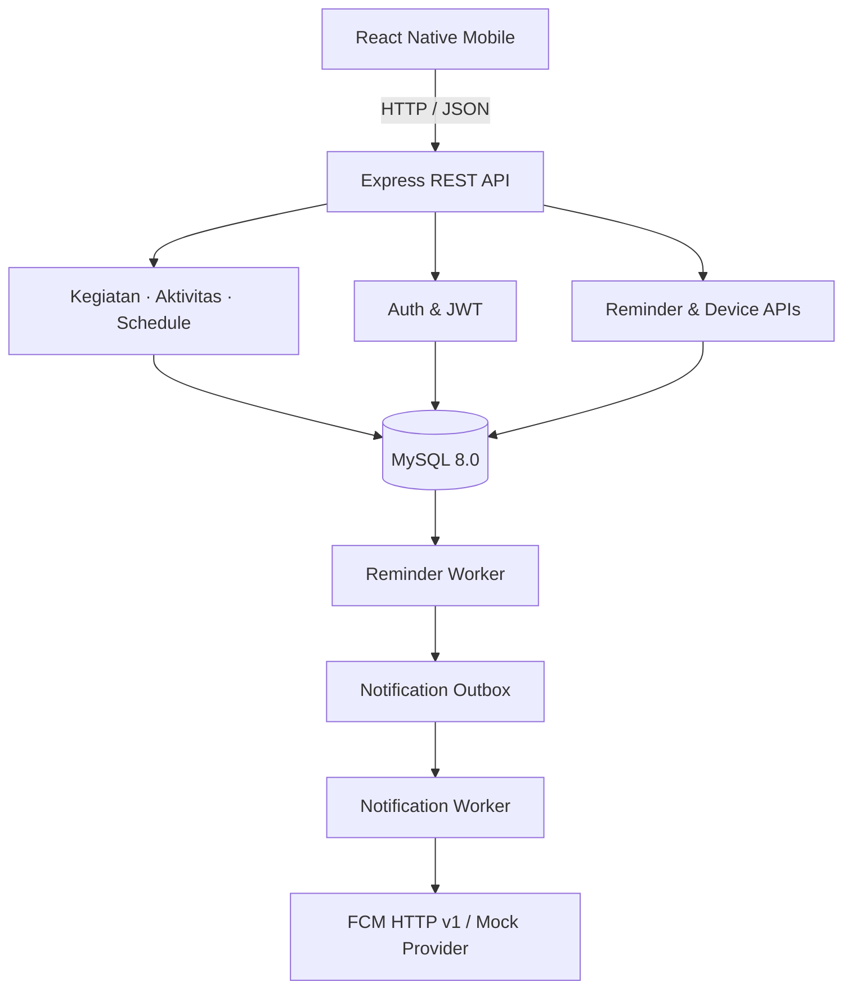

<div align="center">

# SARA Backend

**Smart Assistant for Responsive Automation**

REST API untuk aktivitas, jadwal, reminder, dan notifikasi pada aplikasi SARA.

[](https://nodejs.org/)
[](https://www.typescriptlang.org/)
[](https://expressjs.com/)
[](https://www.mysql.com/)
[](https://yarnpkg.com/)

**[Quick Start](#quick-start) · [API Reference](#api-reference) · [Postman Testing](#postman--frontend-testing) · [Architecture](#architecture) · [Mobile](https://github.com/willysuyanto/sara-mobile)**

</div>

---

## Overview

**SARA** merupakan *smart productivity assistant* untuk membantu pengguna mengelola kegiatan dan aktivitas sehari-hari. Repository ini menangani **REST API, autentikasi, persistensi MySQL, penjadwalan, pengingat, dan pemrosesan notifikasi**. Aplikasi mobile React Native dikerjakan pada repository terpisah.

| Modul | Implementasi pada `main` setelah PR #12 |
| :-- | :-- |
| Authentication | Register, email OTP, resend OTP, login JWT, profil pengguna |
| Kegiatan & Aktivitas | CRUD dengan validasi dan pembatasan kepemilikan JWT |
| Schedule | Agenda berdasarkan rentang waktu dan deteksi benturan |
| Activity History | Audit create, update, delete melalui MySQL triggers |
| Reminder Engine | Reminder CRUD dan worker untuk status `PENDING / DUE / CANCELLED / EXPIRED` |
| Notification | Device registration, delivery outbox, retry, FCM HTTP v1 adapter |
| NLP Service | Perintah Indonesia `CREATE_ACTIVITY` dengan preview, klarifikasi, konfirmasi atomik ([API](docs/api/SARA_NLP_API.md)) |
| Smart Assistance | **Belum tersedia** |

> **Status pengujian:** Pengujian Notification Service memakai provider `mock`. Pengiriman FCM nyata serta end-to-end React Native memerlukan konfigurasi dan pengujian tambahan. `ACCEPTED` berarti FCM menerima request, bukan bukti notifikasi sudah tampil di perangkat.

## Tech Stack

| Komponen | Teknologi |
| :-- | :-- |
| Runtime & API | Node.js, Express 5, TypeScript |
| Package manager | Yarn 3.6.3 |
| Database | MySQL 8.0, `mysql2` |
| Auth & Security | JWT (`jose`), `scrypt`, validation, rate limiting |
| Email verification | Resend OTP |
| Notifications | FCM HTTP v1 / mock adapter |
| Developer tooling | `tsx`, Prettier, Node test runner |
| Database migrations | Versioned SQL + checksum |

## Quick Start

### 1. Prasyarat

Node.js 22 atau 24, Corepack, MySQL 8.0, dan Git. Tim menggunakan Laragon pada lingkungan Windows.

```bash
node --version
corepack --version
mysql --version
```

### 2. Clone & install

```bash
git clone https://github.com/ryanazryan/sara-backend.git
cd sara-backend
corepack enable
yarn install
```

### 3. Environment

Buat `.env` dari template dan isi sesuai komputer:

```bash
cp .env.example .env
```

| Variabel | Keterangan |
| :-- | :-- |
| `PORT` | Port API, default `3000` |
| `DB_HOST`, `DB_PORT`, `DB_NAME` | Koneksi MySQL |
| `DB_USER`, `DB_PASSWORD` | Kredensial MySQL |
| `JWT_SECRET`, `OTP_PEPPER` | Secret independen, masing-masing minimal 32 byte |
| `RESEND_API_KEY`, `RESEND_FROM_EMAIL` | Resend untuk email verifikasi |
| `NOTIFICATION_PROVIDER` | `mock` untuk lokal, `fcm` untuk provider nyata |
| `FCM_SERVICE_ACCOUNT_FILE` | Path absolut service account di luar Git repo |
| `NOTIFICATION_POLL_MS`, `REMINDER_POLL_MS` | Interval polling worker (default 10.000 ms) |

Jangan commit `.env`, password, JWT, FCM device token, atau Firebase service-account JSON. Sender `onboarding@resend.dev` mempunyai batas pengiriman; verifikasi email pengguna umum memerlukan sender domain yang sesuai.

### 4. Database MySQL

Buat database development menggunakan MySQL client:

```sql
CREATE DATABASE IF NOT EXISTS sara
  CHARACTER SET utf8mb4
  COLLATE utf8mb4_unicode_ci;
```

Atur `DB_NAME=sara` di `.env`, kemudian:

```bash
yarn db:check
yarn db:migrate:status
yarn db:migrate
yarn db:migrate:status
```

Hingga PR #12 terdapat **13 migration files**. Jangan mengubah file migrasi yang sudah diterapkan, karena checksum diverifikasi.

### 5. Run

```bash
yarn dev
```

Health check:

```http
GET http://localhost:3000/api/health
```

```json
{
  "success": true,
  "message": "SARA Backend is running"
}
```

## API Reference

**Base URL:** `http://localhost:3000/api` · **Content-Type:** `application/json` · **Auth:** `Authorization: Bearer <JWT>`

| Modul | Path | Cakupan |
| :-- | :-- | :-- |
| Health | `/health` | GET, publik |
| Auth | `/auth/*` | Register, verify email, resend OTP, login, me |
| Kegiatan | `/kegiatan` | List, create, detail, patch, delete |
| Aktivitas | `/aktivitas` | CRUD, status, history, reminder per aktivitas |
| Schedule | `/schedule` | Calendar, conflicts |
| History | `/history` | Audit history global |
| Reminders | `/reminders` | List, detail, patch, cancel |
| Devices | `/devices` | Register/upsert, list, patch, unregister |
| Notifications | `/notifications` | Delivery history |

Alur autentikasi: **Register → OTP email → Verify → Login → JWT → Protected APIs**. Register tidak mengembalikan JWT. Token login berlaku 7 hari, tanpa refresh-token/revoke endpoint saat ini.

Respons sukses menggunakan `success: true`. List menggunakan `data` dan `pagination: {limit, offset, count}`; `count` bukan jumlah total data. Hapus sukses menghasilkan HTTP `204` tanpa body. Resource yang bukan milik pengguna biasanya mengembalikan `404`. Waktu input harus ISO 8601 dengan timezone dan dinormalisasi ke UTC.

Referensi teknis: [API Contract v1](docs/api/SARA_Backend_API_Contract_v1.md) · [Schedule & History](docs/api/SARA_Schedule_History_API.md) · [Reminder](docs/api/SARA_Reminder_API.md) · [Notification & FCM](docs/api/SARA_Notification_API.md) · [NLP](docs/api/SARA_NLP_API.md).

> API Contract v1 merekam implementasi setelah PR #6. Gunakan dokumen modul dan Postman Collection untuk endpoint terbaru. NLP yang tersedia baru mendukung `CREATE_ACTIVITY` berbasis aturan; update/delete/query via NLP, forgot password, refresh token, dan recurring reminders belum tersedia.

## Postman & Frontend Testing

| File | Kegunaan |
| :-- | :-- |
| [`SARA_Backend.postman_collection.json`](postman/SARA_Backend.postman_collection.json) | Semua endpoint + status tests, auto-capture JWT/ID |
| [`SARA_Local.postman_environment.json`](postman/SARA_Local.postman_environment.json) | `baseUrl`, kredensial contoh, variabel ID |
| [`postman/README.md`](postman/README.md) | Panduan urutan pengujian dan troubleshooting |

**Quick flow:** Jalankan API → import collection + environment ke Postman → pilih **SARA Local** → atur `email`/`password` akun test → register → verifikasi OTP → login. JWT tersimpan otomatis sebagai `accessToken`. Create Kegiatan/Aktivitas/Reminder/Device otomatis menyimpan `kegiatanId`, `aktivitasId`, `reminderId`, dan `deviceId`. Grup **09 · NLP** menyimpan `nlpInterpretationId` setelah Parse, lalu memungkinkan preview dan confirm.

Tanggal pada request Aktivitas, Reminder, dan Schedule **dihasilkan dinamis** agar contoh tidak kadaluwarsa. Endpoint yang mengubah/menghapus data tidak dijalankan otomatis oleh collection; jalankan hanya sesuai urutan dan pada lingkungan development.

Untuk React Native, `localhost` di emulator/ponsel **bukan** IP komputer developer. Android Emulator umum memakai `10.0.2.2:3000`; ponsel fisik memerlukan alamat LAN yang bisa diakses serta pengaturan jaringan yang sesuai.

## Architecture



Worker sebagai proses terpisah:

```bash
# sekali jalan
yarn reminders:run
yarn notifications:run

# polling berkelanjutan
yarn reminders:worker
yarn notifications:worker
```

`notifications:worker` sudah menjalankan scheduler reminder saat dispatch; tidak wajib menjalankan kedua worker bersamaan. External push bersifat **at-least-once**, bukan exactly-once.

## Developer Commands

| Command | Kegunaan |
| :-- | :-- |
| `yarn dev` | Server development |
| `yarn build` / `yarn start` | Compile dan jalankan build |
| `yarn typecheck` | Static check TypeScript |
| `yarn db:check` | Cek koneksi MySQL |
| `yarn db:migrate:status` | Status migrasi |
| `yarn db:migrate` | Terapkan migrasi |
| `yarn reminders:run` | Sekali proses reminder |
| `yarn notifications:run` | Sekali proses notification |
| `yarn test:db-migrations` | Test migrasi |
| `yarn format:check` | Check Prettier |

Gunakan database **`sara_migration_test`** untuk integration test otomatis (test dapat menghapus data):

```bash
DB_NAME=sara_migration_test yarn db:migrate
yarn typecheck
yarn build
yarn tsc -p tests/tsconfig.json --pretty false
DB_NAME=sara_migration_test NOTIFICATION_PROVIDER=mock yarn tsx --test tests/notification.api.integration.test.ts
```

## Project Structure

```text
sara-backend/
├── database/migrations/     # SQL migrations & audit triggers
├── docs/api/                # API specifications
├── postman/                 # Collection + environment + usage guide
├── src/
│   ├── config/              # MySQL connection
│   ├── controllers/         # HTTP handlers
│   ├── db/                  # Migration runner
│   ├── middlewares/         # Auth / error handler
│   ├── routes/              # REST endpoints
│   ├── services/            # Business logic & notification adapters
│   ├── validators/          # Validation
│   └── workers/             # Schedulers
├── tests/                   # Unit & integration tests
├── .env.example
├── package.json
└── README.md
```

## Collaboration

- [SARA Backend repository](https://github.com/ryanazryan/sara-backend)
- [SARA Mobile — React Native](https://github.com/willysuyanto/sara-mobile)
- [SARA workspace — Notion](https://app.notion.com/p/3e173f8cd49980d0b374eb7ee56e5afe)

Gunakan **short-lived branch → commit → PR → review → merge ke `main`**. Pisahkan status implementasi, keputusan scope, dan pengujian eksternal agar klaim kesiapan tetap akurat.

---

<div align="center">

**SARA · Smart Assistant for Responsive Automation**  
Proyek akademik — Implementasi dan Pengujian Perangkat Lunak (IMPAL)

</div>
